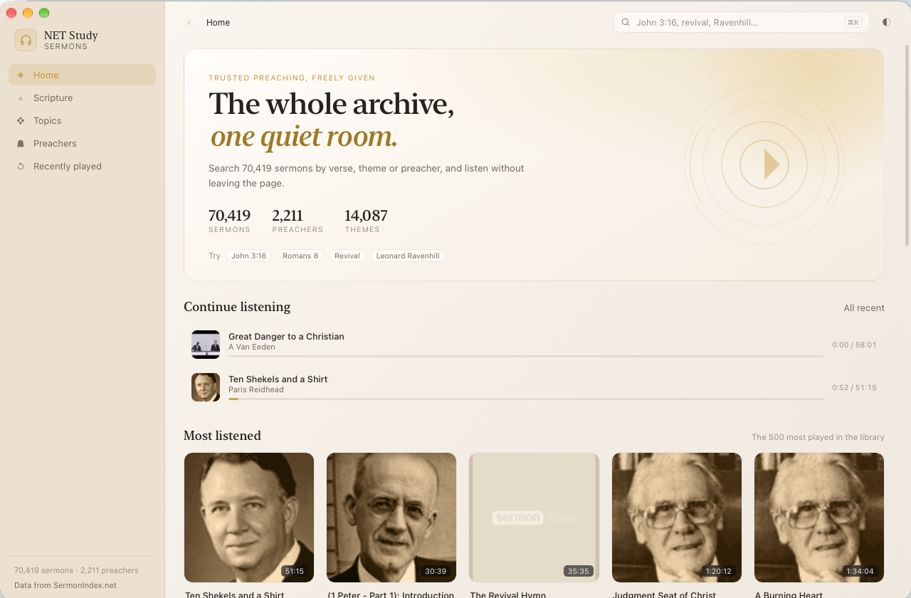
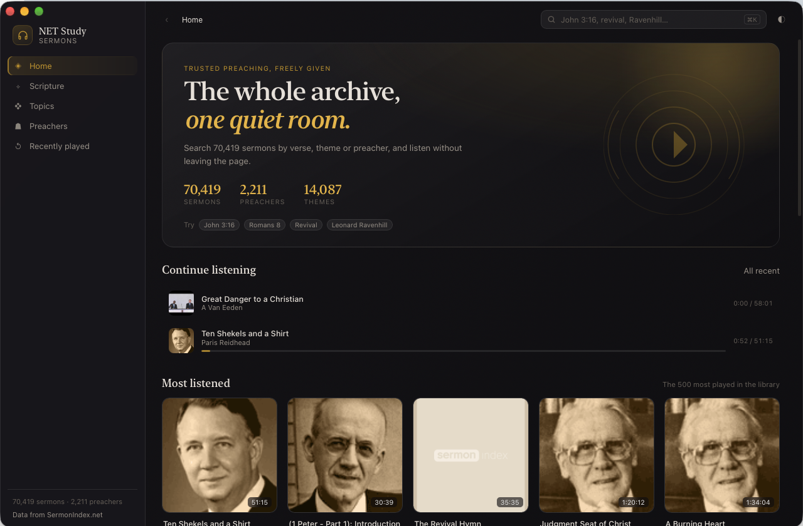

# NET Study Sermons

A quiet desktop browser and player for the [SermonIndex](https://www.sermonindex.net) archive: 70,419 sermons from 2,211 preachers across 14,087 themes, searchable by scripture reference, theme or name.

Built with Tauri 2, so the whole app is about 5 MB and starts instantly.



## What it does

- **Search by scripture.** Type `John 3:16`, `rom 8`, `1 cor 13:4-7`, `psalm 23` or `jn 3 16`. Almost any spelling of a book works, including OSIS codes.
- **Browse by book, chapter and verse.** Heat shading shows where the preaching actually falls, and every verse with sermons is one click away.
- **Browse 14,087 themes and 2,211 preachers**, filtered as you type.
- **Listen in place.** Audio streams from Archive.org with a CDN fallback, played by a persistent bar with a queue, 15-second rewind, 30-second forward, speed control and per-sermon resume.
- **Watch the video sermons** in a theatre overlay; audio keeps its place when you switch.
- **Recently played** remembers position, even after a quit.
- **Light and dark**, both derived from the NET Study plum-and-gold palette, following the system by default.



## The data

Everything comes from the free [SermonIndex API v2](https://sermonindex.net/api/reference/). No key, no rate limit, CORS open. A few notes on how this app treats it:

- API responses are cached on disk for between one day and a week depending on the endpoint, in `~/Library/Caches/org.vellum.netstudysermons/responses/`. Stale copies are served when the network is down.
- The theme and preacher directories are built once from the bulk downloads (`topics.json.gz`, 9.9 MB; `speakers.json.gz`, 266 KB), streamed and reduced to a small index in `~/Library/Application Support/org.vellum.netstudysermons/index/`. They refresh after 14 days.
- Nothing is re-hosted. Audio and video stream from SermonIndex's mirrors.

Sermons remain the property of the preachers and ministries who hold their rights. SermonIndex asks that the material stay free; this app has no paid tier, no ads and no tracking.

## Build

Requires macOS 12+, Node 20+ and a Rust toolchain.

```sh
npm install
npm run tauri dev      # development window
npm run tauri build    # NET Study Sermons.app + .dmg in src-tauri/target/release/bundle
```

The macOS bundle is `org.vellum.netstudysermons`. The app icon is drawn by `tools/makeicon.swift`, so it can be regenerated without any design files:

```sh
swift tools/makeicon.swift /tmp/icon.png
```

## Test

```sh
npm run build
npm run smoke
```

`scripts/smoke.mjs` serves the built frontend, shims the Tauri bridge with recorded API responses, and drives the real UI in headless Chrome: 22 checks covering the hero, reference parsing, playback and queue, sermon detail, preacher pages, the scripture and theme browsers, filters, the player bar and console errors.

## How it is put together

```
src/            TypeScript frontend, no framework
  api.ts        typed API client, reference parser, formatting
  player.ts     audio/video engine, queue, resume, fallbacks
  main.ts       views, router, search, player bar
src-tauri/      Rust backend
  src/lib.rs    cached GET proxy, topic/speaker index builder, state file
```

The webview never talks to the network directly except for images and media. Every JSON request goes through one Rust command, `api_get`, which owns the cache and the CDN fallback, which keeps the UI code boring and offline-tolerant.

## Roadmap

- Windows and Linux bundles (the code is portable; the macOS window chrome and menu bar are the only platform-specific parts)
- Full-text search over transcripts using the `sermons.json.gz` bulk file
- Downloads for offline listening

---

From the makers of [NET Study](https://github.com/NET-Study/netstudy-mac). GPL-3.0.
